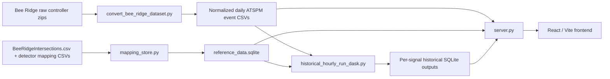
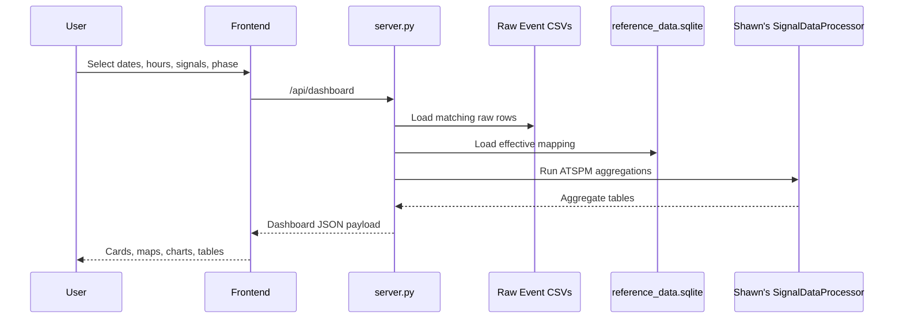
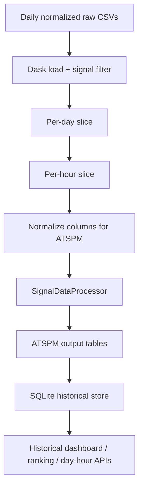
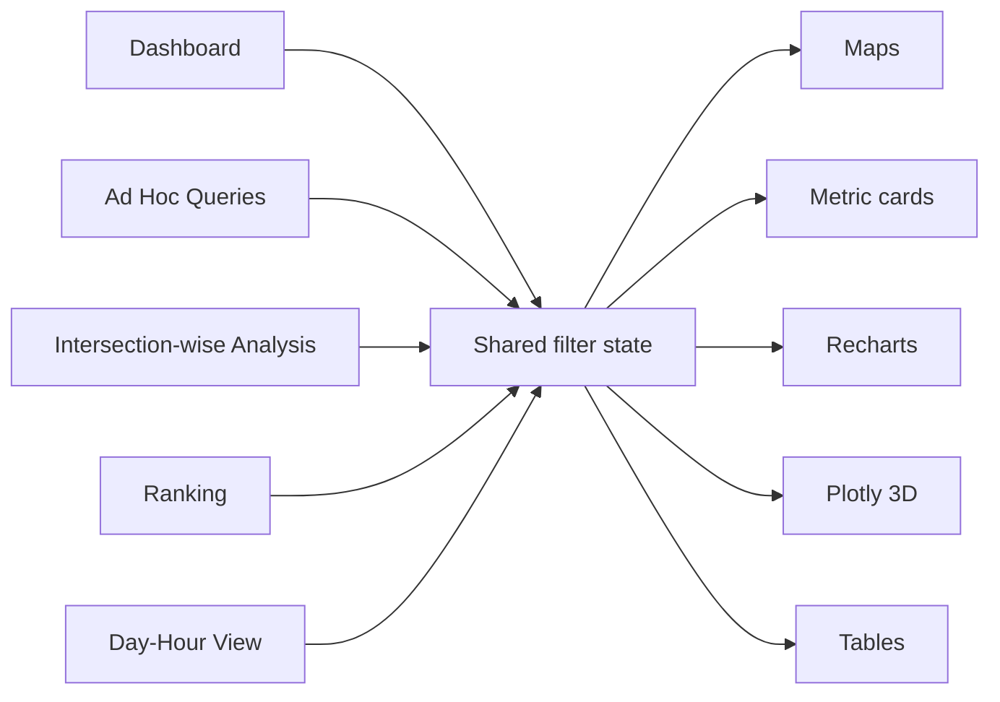
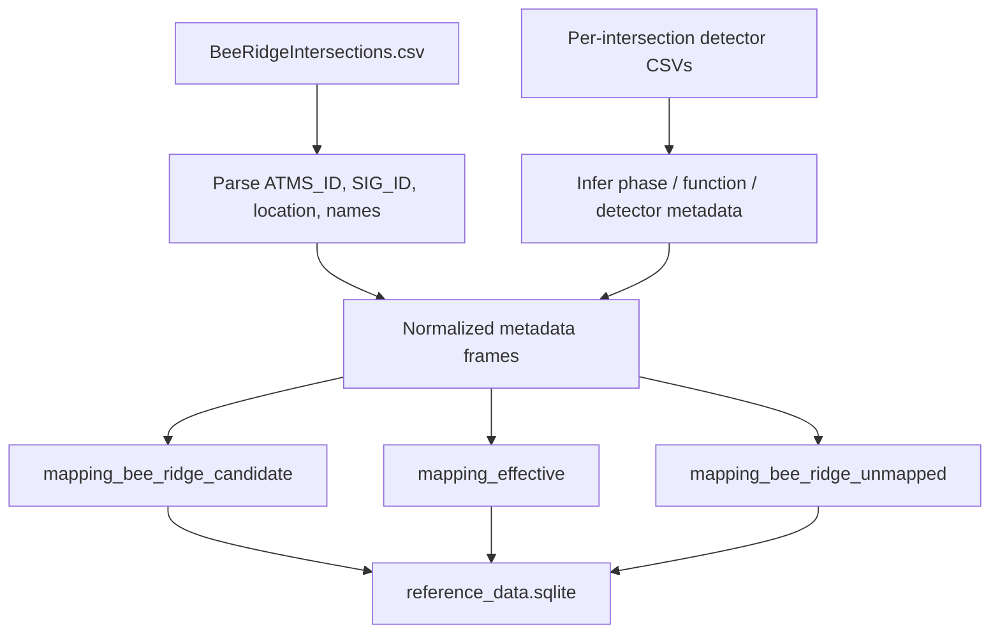

# Bee Ridge ATSPM Codebase Transcript

Note: this is a codebase-grounded transcript generated from direct inspection of the local repository. It is not a pasted external ChatGPT conversation, but it is written in the same Q&A / report-building style so you can reuse it directly.

## Transcript

### Q1. What is this software system at a high level?

This project is a custom traffic-signal analytics dashboard for Bee Ridge Road ATSPM data. Conceptually, it is a layered system built on top of Shawn Strasser's `atspm` Python package. The custom repository provides three major additions around Shawn's analytics engine:

1. A frontend dashboard application for exploring ATSPM results visually.
2. A lightweight local backend API server that orchestrates raw-data reads, filtering, aggregation, and payload formatting.
3. Conversion and historical-processing scripts that adapt Bee Ridge controller exports into the data shape expected by the ATSPM tooling and then generate persistent derived outputs.

The core idea is that the project does not reinvent the ATSPM metric engine itself. Instead, it uses Shawn's `SignalDataProcessor` from the `atspm` package as the analytics kernel, while this repository handles:

- Bee Ridge dataset normalization
- detector and intersection metadata normalization
- runtime APIs for the dashboard
- custom historical and ranking workflows
- presentation logic for maps, charts, ranking, and day-hour analysis

So the software is best understood as a custom application layer around a reusable ATSPM computation library.

### Q2. What are the main repositories or code areas involved?

There are really three logical codebases in play:

1. This custom repository
   - `dashboard-app/` for the React frontend
   - `backend/` for the Python HTTP API and data-processing scripts
   - top-level docs and setup instructions

2. Shawn Strasser's `atspm` repository
   - cloned locally as `./atspm`
   - provides the actual ATSPM aggregation engine
   - includes `SignalDataProcessor` and the underlying event-to-metric logic

3. Shawn Strasser's `atspm-report` repository
   - cloned locally as `./atspm-report`
   - referenced in project setup documentation
   - not visibly imported into the runtime path of this custom dashboard, but part of the local development ecosystem

In other words, the runtime dependency that matters most is Shawn's `atspm` package. The custom code depends on it directly to compute metrics. `atspm-report` appears to be a related but separate reporting toolchain rather than a live dependency of the dashboard itself.

### Q3. What problem does the software solve?

The software turns raw event data from traffic signal controllers into interpretable operational performance measures and then exposes those measures in multiple analytical views.

For Bee Ridge specifically, the project supports:

- corridor-wide dashboard views
- per-intersection analysis
- ranking and relative scoring across intersections
- day-hour heatmaps and 3D day-hour surfaces
- ad hoc filtered analysis windows
- precomputed historical summaries stored in SQLite

This makes the system useful for transportation engineering analysis, troubleshooting, and corridor-level operational review.

At a workflow level, the software solves the following sequence:

1. Raw controller exports arrive in Bee Ridge-specific zip/csv form.
2. Those files are normalized into ATSPM-style event rows.
3. Detector/channel mapping files are normalized into a reference database.
4. The ATSPM engine derives metrics from those normalized events plus detector mapping.
5. The backend converts those results into API payloads.
6. The frontend renders maps, comparisons, rankings, charts, and detailed views.

### Q4. What does the directory structure tell us about the architecture?

The structure is strongly modular and splits by responsibility:

#### `dashboard-app/`

This is the user-facing React application. It contains:

- `src/App.tsx`
  - the main UI composition and almost all view logic
- `src/styles.css`
  - the global styling and layout system
- `vite.config.ts`
  - Vite build/dev-server configuration
- `package.json`
  - frontend dependencies and scripts

#### `backend/`

This contains the server-side application logic:

- `server.py`
  - the local HTTP API server
  - request parsing
  - filtering
  - payload construction
  - orchestration of historical build workflows

- `convert_bee_ridge_dataset.py`
  - converts raw Bee Ridge controller exports into normalized ATSPM event CSV files

- `mapping_store.py`
  - reads Bee Ridge metadata CSVs
  - normalizes detector mappings
  - writes a SQLite reference database

- `historical_hourly_run_dask.py`
  - scalable historical aggregation path
  - loads daily raw files, filters by signal, slices by day/hour, runs `SignalDataProcessor`
  - writes persistent SQLite outputs

- `historical_hourly_run.py`
  - likely a smaller/non-Dask historical processing path

- `historical_hourly_run_all_days.py`
  - all-day historical batch workflow

- `detector_config_overlays.py`
  - compatibility overlays for detector configs, especially legacy/special-case signal handling such as `1240`

#### `atspm/`

This is Shawn Strasser's analytics package. The custom backend imports from `atspm/src` and uses:

- `SignalDataProcessor`

That means the custom application delegates the heavy ATSPM metric calculation to the upstream library.

### Q5. What frontend technologies are used?

The frontend stack is:

- React 18
- TypeScript
- Vite
- Recharts
- Leaflet
- React Leaflet
- Plotly via `react-plotly.js`

From `dashboard-app/package.json`, the main dependencies are:

- `react`
- `react-dom`
- `leaflet`
- `react-leaflet`
- `recharts`
- `plotly.js-dist-min`
- `react-plotly.js`

That gives a nice separation of visualization roles:

- Leaflet for spatial context and maps
- Recharts for conventional charts
- Plotly for richer interactive charting such as the 3D day-hour surface

Vite is used for local development and builds, and TypeScript provides static typing in the UI layer.

### Q6. What backend technologies are used?

The backend is a Python application using a relatively minimal stack:

- Python standard library HTTP server (`BaseHTTPRequestHandler`, `ThreadingHTTPServer`)
- `pandas`
- `sqlite3`
- `dask.dataframe`
- Shawn Strasser's `atspm` package

This is notable because the backend does not appear to use Flask, FastAPI, or Django. Instead, it uses the standard library HTTP primitives directly. That makes the backend lightweight and straightforward, but also means routing, serialization, and error handling are custom-managed in `server.py`.

The backend also relies on:

- local filesystem access
- CSV-based raw event storage
- SQLite for precomputed/historical persistence
- pandas DataFrames for transformation and output shaping

### Q7. How does the raw Bee Ridge dataset enter the system?

The Bee Ridge raw-data ingestion path is handled by `backend/convert_bee_ridge_dataset.py`.

Its responsibilities are:

1. Read `BeeRidgeIntersections.csv`
   - this tells the system which ATMS intersection IDs exist
   - it also tells the code which mapping CSV belongs to each intersection

2. For each intersection, locate a corresponding source zip
   - expected naming pattern: `Ctrl0{signal_id}.zip`

3. Open each zip and scan its member CSVs
   - member file names are parsed to determine date keys

4. Parse raw event rows
   - each row is converted into the normalized ATSPM raw format:
     - `signalID`
     - `timeStamp`
     - `eventCode`
     - `eventParam`

5. Write per-signal, per-day temporary outputs
   - one normalized CSV per signal per day

6. Merge those into corridor-wide per-day files
   - final output example:
     - `derived/bee_ridge_atspm_v3/atspm-2026-2-23_filtered.csv`

So the converter acts as a translation layer between Bee Ridge's source export format and Shawn's ATSPM event-log input format.

### Q8. What is the normalized raw event format expected by the rest of the system?

The rest of the pipeline expects ATSPM-style event rows with exactly these semantic columns:

- `signalID`
- `timeStamp`
- `eventCode`
- `eventParam`

This matters because it means the custom conversion layer exists primarily to coerce the Bee Ridge source into the canonical ATSPM event schema. Once data is in that shape, the backend and Shawn's library can process it in a consistent way.

### Q9. How is intersection metadata and detector mapping handled?

This is one of the most important custom pieces in the repository.

The project does not simply query mapping CSV files directly at runtime. Instead, it uses `backend/mapping_store.py` to build a normalized SQLite reference database.

The mapping-store workflow is:

1. Load `BeeRidgeIntersections.csv`
   - parse `ATMS_ID`
   - parse `SIG_ID`
   - parse geographic `Location`
   - synthesize intersection names and roadway labels

2. Derive normalized intersection metadata fields such as:
   - `name`
   - `latitude`
   - `longitude`
   - `roadway_name`
   - `route`
   - `county`

3. Load each per-intersection detector mapping CSV
   - infer or read detector ID, phase, movement, detector type, stop-bar distance, etc.

4. Normalize these into a consistent schema
   - `DeviceId`
   - `Phase`
   - `Parameter`
   - `Function`
   - `laneType`
   - `detectorID`
   - `distanceToStopbar`
   - and source-tracking columns

5. Split the mapping into:
   - candidate rows
   - effective mapped rows
   - unmapped/candidate-only rows

6. Persist those tables into `derived/reference_data.sqlite`

That means the mapping data becomes a durable internal reference layer rather than a loose collection of CSVs.

### Q10. Why is the mapping database important architecturally?

It is important because it formalizes what would otherwise be a very fragile part of the system.

Without a mapping store:

- the backend would need to reopen many CSVs repeatedly
- there would be inconsistent schema handling
- runtime queries would be tightly coupled to file names and field names
- debugging provenance would be harder

With the mapping store:

- the app has a normalized reference layer
- candidate vs effective mappings can be distinguished
- source provenance can be tracked
- downstream processing can use a stable schema
- metadata such as location and naming is centralized

From a software design standpoint, `mapping_store.py` is effectively the metadata integration layer of the application.

### Q11. What exactly is Shawn's role in the codebase?

Shawn's work is the metric-computation engine, not the custom UI or Bee Ridge-specific adaptation logic.

The direct evidence is:

- project README says this repository is built on top of Shawn Strasser's `atspm` tooling
- backend imports `SignalDataProcessor` from `atspm`
- upstream `atspm` README describes the package as the event-log-to-performance-measure engine

So in report language, Shawn's code provides:

- event-log loading
- aggregation orchestration
- metric generation
- ATSPM domain logic
- timeline generation
- arrival-on-green, split failure, terminations, phase wait, coordination, and related measures

The custom repository wraps and operationalizes that engine for a Bee Ridge-specific dashboard application.

### Q12. Which ATSPM measures are being used in practice here?

The backend configures the ATSPM engine to produce a specific set of tables. In `historical_hourly_run_dask.py`, the aggregation tables include:

- `has_data`
- `arrival_on_green`
- `split_failures`
- `terminations`
- `timeline`
- `phase_wait`
- `coordination_agg`

These are then transformed into user-facing concepts like:

- AOG %
- AOR %
- average wait
- green occupancy
- red occupancy
- split failures
- max-outs
- gap-outs
- force-offs
- cycle length
- actuation volume

The dashboard is therefore not just a raw event viewer. It is a curated presentation layer over derived operational performance metrics.

### Q13. How does the historical processing pipeline work?

The historical pipeline is implemented primarily in `backend/historical_hourly_run_dask.py`.

Its flow is:

1. Find all normalized daily raw files
2. Load them with Dask
3. Filter rows down to one signal
4. Parse timestamps
5. Enforce that row timestamps match the daily file they came from
6. Add derived `run_date` and `hour` fields
7. Materialize into pandas
8. For each day:
   - create a day folder
   - save a filtered daily CSV
9. For each hour in each day:
   - create an hourly CSV slice
   - if empty, mark it as empty
   - if not empty:
     - normalize columns into ATSPM input names
     - run `SignalDataProcessor`
     - extract ATSPM result tables
     - write those tables into a SQLite database

This creates a persistent per-signal historical SQLite output, which can be used later by the historical dashboard, ranking, and day-hour views without recomputing everything on each UI request.

### Q14. Why use Dask here?

Dask is used only where it makes sense: loading and filtering very large raw CSV collections. The code does not try to make the whole application distributed. Instead, it uses Dask as a scalable file-ingestion helper and then converts down to pandas when the working set is manageable.

This is a pragmatic design choice:

- Dask helps with large raw event datasets
- pandas remains simpler for downstream per-signal/per-hour logic
- the ATSPM library itself is then invoked on ordinary DataFrames

So Dask is a selective scalability tool, not the core application framework.

### Q15. What does the live backend API do?

`backend/server.py` is the central orchestration layer for runtime requests.

It handles several responsibilities:

- discover which raw files exist
- infer default analysis windows
- load mapping metadata
- determine available intersections
- filter data by date/day/time/phase/intersection
- compute live/ad hoc summaries from raw event files
- serve precomputed historical outputs from SQLite
- build ranking payloads
- build day-hour payloads
- trigger or ensure historical builds

It exposes routes such as:

- `/api/dashboard`
- `/api/historical-dashboard`
- `/api/historical-run`
- `/api/ranking`
- `/api/day-hour`

This means `server.py` is effectively the application controller layer.

### Q16. What is the difference between Dashboard and Ad Hoc Queries?

Conceptually the application has two very different dashboard modes:

1. `Dashboard`
   - backed by precomputed historical SQLite outputs
   - optimized for quick reads of already-derived measures
   - good for stable repeatable analysis

2. `Ad Hoc Queries`
   - backed by raw filtered event CSV files
   - recomputes the selected window on demand
   - more flexible but computationally more expensive

This distinction is important in the UI and in the architecture:

- precomputed view favors responsiveness and persistence
- ad hoc view favors flexibility and fine-grained custom filtering

The application explicitly warns that fine-grained ad hoc queries can take seconds to minutes.

### Q17. How are filter values represented across the app?

The frontend maintains a common filter state including:

- `dateFrom`
- `dateTo`
- `daysOfWeek`
- `hourFrom`
- `hourTo`
- `timeOfDayPreset`
- `selectedPhase`

For dashboard views, it also tracks selected intersection IDs.

This is a good design because it creates a common filtering language across views. The same date/day/hour logic can feed:

- dashboard summaries
- ranking
- historical dashboard
- day-hour analysis

In practice, that gives the user a consistent mental model: the selected time window and intersection scope drive the whole app.

### Q18. What are the major frontend views?

The main views in `App.tsx` are:

- `Dashboard`
- `Intersection-wise Analysis`
- `Ranking`
- `Day-Hour View`
- `Ad Hoc Queries`

Each serves a different analytical purpose:

#### Dashboard

Presents a corridor-level or selected-intersection operational summary using precomputed results.

#### Intersection-wise Analysis

Focuses on one signal at a time and exposes saved-run details, including day/hour status and historical run outputs.

#### Ranking

Classifies intersections comparatively using composite score logic and quartile-style MOE tables.

#### Day-Hour View

Shows day-versus-hour aggregation patterns, including heatmap/table and 3D surface exploration.

#### Ad Hoc Queries

Runs direct, on-demand computation over raw normalized event data for a user-selected filter window.

### Q19. How is the map used in the frontend?

Leaflet maps appear in multiple analytical contexts:

- dashboard corridor map
- historical signal map
- ranking map
- day-hour selected-signal map

The map is not just decorative. It plays a functional role:

- showing physical spatial context
- preserving corridor order
- linking ranked or selected intersections back to geography
- helping users understand whether a metric issue is localized or corridor-wide

In the ranking view specifically, the map now supports selection coupling: choosing a rank-card focuses the map on that exact intersection.

### Q20. How does the ranking system work?

The ranking logic in the frontend computes a custom relative score from several MOEs.

The scoring formula uses weighted components including:

- AOG
- AOR
- average wait
- split failures
- max-outs
- force-offs

The weights are editable in the UI, and the code normalizes those weights so they sum effectively to 100%.

From there:

1. intersections with data are scored
2. rows are sorted by composite score
3. quartile thresholds are derived
4. each row is classified into:
   - Top Quartile
   - Upper-Mid
   - Lower-Mid
   - Bottom Quartile
   - No data

This ranking data is then rendered in several coordinated ways:

- classification summary stats
- a map with rank-colored markers
- a ranked list panel
- a MOE table with quartile coloring
- a scatter/bubble plot

### Q21. How does the day-hour view work?

The day-hour view is driven from the `/api/day-hour` endpoint and is intended to summarize how a selected metric varies by day and hour.

Its output is represented as a day-hour matrix. The frontend then renders that matrix in multiple forms:

- exact table
- heatmap-style colored matrix
- interactive 3D Plotly surface

This is an important design decision because it supports both precision and exploration:

- the table is best for exact reading
- the 3D surface is best for pattern recognition, peaks, and valleys

The UI also includes focus/highlight behavior so users can inspect a selected day-hour cell more closely.

### Q22. How is UI state coordinated?

The frontend keeps most state in one main `App` component. This is somewhat monolithic structurally, but practical for a small-to-medium internal analytics app.

The benefits are:

- centralized filter management
- clear routing via tab state
- easy cross-view reuse of dashboard payloads

The tradeoff is that `App.tsx` becomes large and responsibilities are mixed:

- API calls
- filter state
- rendering
- interaction logic
- data shaping for charts

So from a software engineering standpoint, this is a functional but somewhat centralized UI architecture. If the application grows further, splitting into more focused components and hooks would likely improve maintainability.

### Q23. What are the key custom modules in the backend?

The key custom backend modules are:

#### `server.py`

Primary backend application controller. Handles routing, filtering, payload generation, metadata lookup, and integration with historical outputs.

#### `convert_bee_ridge_dataset.py`

The Bee Ridge-specific normalization script. Converts source exports into the canonical ATSPM raw event shape.

#### `mapping_store.py`

The metadata normalization layer. Converts Bee Ridge intersection and detector mapping files into a SQLite reference database.

#### `historical_hourly_run_dask.py`

The scalable historical metric build pipeline. Creates signal-level SQLite outputs for later use.

#### `detector_config_overlays.py`

A compatibility shim for detector overlays, especially where a special-case signal required a supplemental detector mapping layer.

### Q24. Does the project still carry some legacy artifacts?

Yes. The codebase has evolved from earlier datasets and intermediate migration steps, so a report should acknowledge that there are legacy traces.

Examples include:

- some route or internal identifiers that reflect older ATSPM naming conventions
- detector overlay support for legacy `1240` compatibility work
- historical naming in some comments or titles even though the user-facing copy has been simplified

This is typical in a working engineering application: the final UI may be Bee Ridge-specific, while some internal implementation details still reflect earlier iterations of the project.

### Q25. What data assumptions are baked into the backend?

Several important assumptions are encoded:

- raw file names follow the `atspm-Y-M-D_filtered.csv` pattern
- Bee Ridge source zips follow a `Ctrl0{signal_id}.zip` naming convention
- mapping CSVs are discoverable through `BeeRidgeIntersections.csv`
- timestamps can be normalized into the format expected by ATSPM processing
- detector mappings can be inferred or cleaned sufficiently to provide `DeviceId`, `Phase`, `Parameter`, and `Function`
- the newest file may be partial, so default-date logic can prefer the previous day

These assumptions are crucial because they make the pipeline deterministic. They also mean the system is not yet a completely generic ATSPM ingestion platform; it is a Bee Ridge-oriented implementation with well-defined source conventions.

### Q26. What are the main outputs produced by the system?

There are several distinct output layers:

#### Normalized daily raw event files

These live under a derived Bee Ridge directory and act as the canonical runtime raw source.

#### Reference metadata SQLite

`derived/reference_data.sqlite`

This stores intersection and mapping metadata in normalized relational form.

#### Historical per-signal SQLite outputs

Each signal gets a derived SQLite store containing:

- run metadata
- run status by day/hour
- ATSPM aggregate tables

These are used for the precomputed dashboard experiences.

#### JSON API payloads

The frontend consumes JSON from the backend for all interactive views.

### Q27. How should the frontend-to-backend flow be described?

The frontend does not compute ATSPM metrics itself. It is a presentation and interaction layer. The backend owns filtering, ATSPM invocation, payload shaping, and historical lookup.

The flow is:

1. User changes filters or tabs in React.
2. React builds query parameters.
3. React calls a backend route on `127.0.0.1:8000`.
4. Backend reads raw files or precomputed SQLite outputs.
5. Backend loads mapping metadata as needed.
6. Backend either:
   - computes results from raw event data, or
   - reads precomputed historical results
7. Backend returns a structured JSON payload.
8. Frontend turns that payload into cards, maps, plots, tables, and summaries.

### Q28. What is the role of SQLite in the architecture?

SQLite plays two important but different roles:

#### Metadata store

`reference_data.sqlite`

This is the normalized metadata layer for intersections and detector mappings.

#### Historical result store

Per-signal historical result databases under derived output directories.

These store precomputed MOEs and run-status data for repeatable analysis without rerunning expensive computations each time.

So SQLite is being used both as:

- a lightweight relational metadata store
- a lightweight persistence layer for analytical outputs

This is a strong fit for a local analytics application because it is simple, file-based, portable, and fast enough for the scale of this corridor project.

### Q29. How does the project balance precomputed vs live computation?

This is one of the most important architectural themes in the software.

The project deliberately supports both:

#### Precomputed analysis

- faster user experience
- stable outputs
- historical comparison
- lower runtime cost during interaction

#### Live/ad hoc computation

- flexible slicing
- direct use of raw event files
- more experimental or exploratory analysis
- higher runtime cost

This dual-path design is very sensible for transportation analytics because users often need both operational dashboards and investigative deep dives.

### Q30. What are the main strengths of the codebase?

Key strengths include:

- clear separation between UI, API, and metric engine
- practical reuse of Shawn Strasser's ATSPM package instead of duplicating domain logic
- explicit dataset normalization layer for Bee Ridge
- explicit metadata normalization layer via SQLite
- support for both precomputed and ad hoc workflows
- strong visual exploration capabilities in the frontend
- integration of spatial, comparative, and temporal views

In short, the project is not just a raw dashboard. It is a fairly complete corridor analytics application with ingestion, normalization, computation, persistence, API exposure, and interactive visualization.

### Q31. What are the main architectural weaknesses or risks?

Main weaknesses or risks include:

- `App.tsx` is large and centralizes a lot of UI responsibilities
- backend routing is hand-rolled with the Python standard library rather than a richer web framework
- several conventions are dataset-specific rather than fully generalized
- some compatibility logic reflects migration history, which can make future maintenance more complex
- runtime behavior still depends heavily on local file naming and local filesystem layout

None of these make the system unsound, but they are useful to mention in a report because they indicate where future refactoring could improve scalability or maintainability.

### Q32. How would you summarize the software in one paragraph for a report?

This software is a custom Bee Ridge Road ATSPM analytics platform built around Shawn Strasser's `atspm` processing library. It ingests Bee Ridge controller event exports, converts them into normalized ATSPM event files, normalizes intersection and detector metadata into a SQLite reference store, and then exposes both precomputed historical outputs and on-demand ad hoc analysis through a Python backend and a React/Vite frontend. The application supports corridor dashboards, intersection-level analysis, comparative ranking, day-hour visualizations, interactive maps, and 3D exploratory views, combining transportation domain analytics with a modern local analytics UI.

## Diagrams

### 1. System Overview

### 2. Ad Hoc Query Flow

### 3. Historical Build Flow

### 4. Frontend View Model

### 5. Metadata Normalization Flow

## Short pull-quotes you can reuse

- The custom repository is an application layer around Shawn Strasser's `atspm` analytics engine.
- The Bee Ridge pipeline has two normalization steps: raw event normalization and metadata/mapping normalization.
- The frontend is a React/Vite analytics UI using Leaflet, Recharts, and Plotly.
- The backend is a lightweight Python HTTP server that coordinates raw-file reads, ATSPM execution, and historical SQLite access.
- The software intentionally supports both precomputed analysis and flexible ad hoc recomputation.

